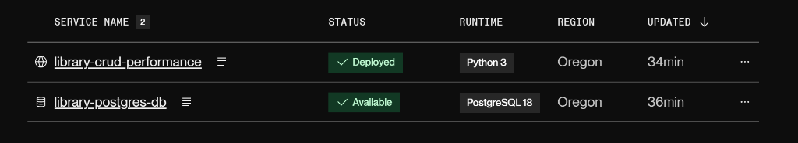
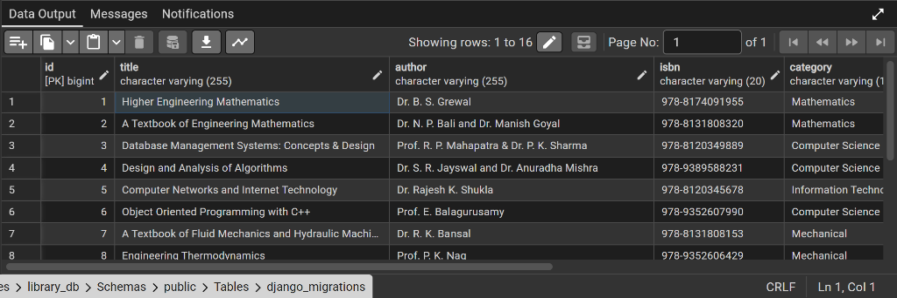
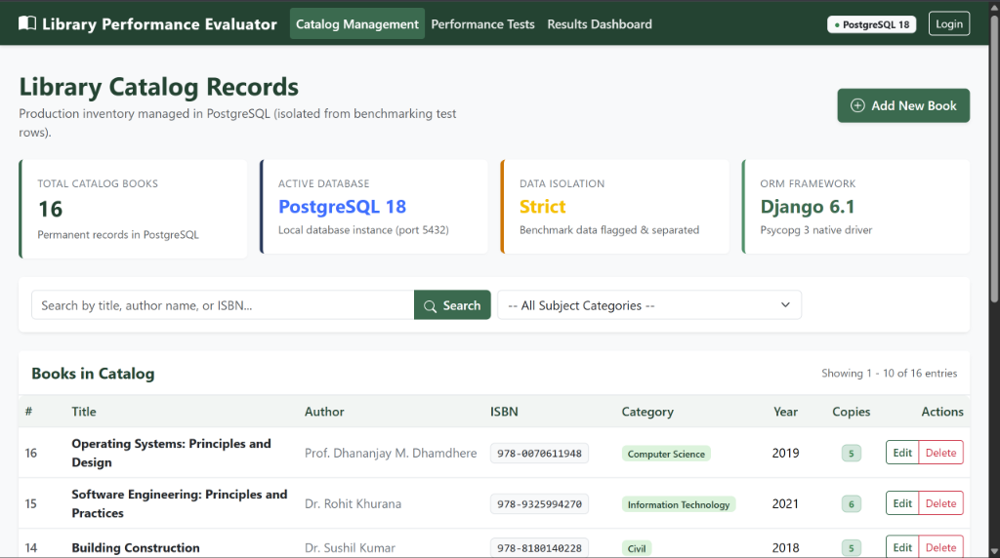
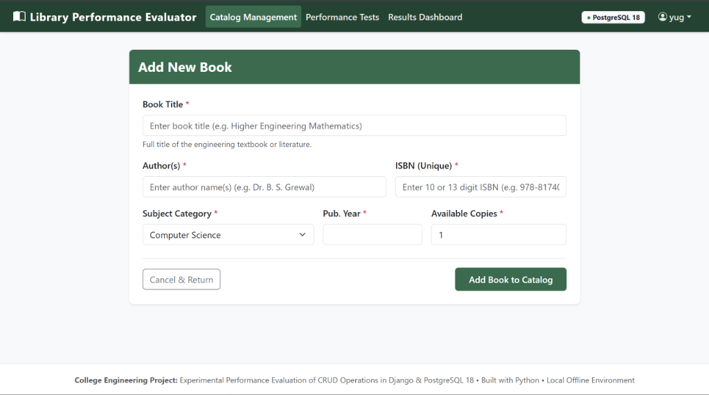
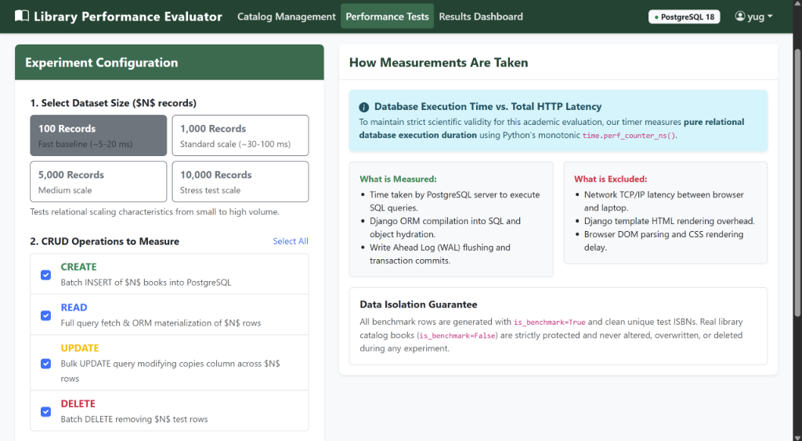
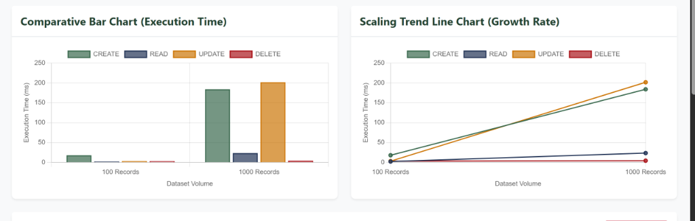

# A PROJECT REPORT ON
# EXPERIMENTAL PERFORMANCE EVALUATION OF CRUD OPERATIONS IN A DJANGO-BASED LIBRARY RECORD APPLICATION

---

### Submitted in partial fulfillment of the requirements for the award of the degree of
### **BACHELOR OF TECHNOLOGY / BACHELOR OF COMPUTER APPLICATIONS**
### In
### **COMPUTER SCIENCE AND ENGINEERING**

---

### **Submitted By:**
1. **Yug Savani** (Enrollment No: `12402110501068`)  
2. **Hitarth Desai** (Enrollment No: `12402110501072`)  

**Under the Guidance of:**  
Faculty / Project Supervisor  

**Department of Computer Science & Engineering**  
**Academic Year:** 2026 – 2027  

---

## CANDIDATE DECLARATION

We hereby declare that the project work entitled **"Experimental Performance Evaluation of CRUD Operations in a Django-Based Library Record Application"** submitted to the Department of Computer Science & Engineering is a record of original work done by us under the guidance of our project supervisor.

The results embodied in this report have not been submitted to any other University or Institute for the award of any degree or diploma.

**Date:** 27 October 2026  
**Place:** Gujarat, India  

1. **Yug Savani** (Enrollment No: `12402110501068`)  
2. **Hitarth Desai** (Enrollment No: `12402110501072`)  

---

## TABLE OF CONTENTS

1. [Abstract](#abstract)
2. [Chapter 1: Introduction](#chapter-1-introduction)
   - 1.1 Background & Motivation
   - 1.2 Problem Statement
   - 1.3 Project Objectives
   - 1.4 Scope of the Project
3. [Chapter 2: System Specifications & Architecture](#chapter-2-system-specifications--architecture)
   - 2.1 Hardware and Software Environment
   - 2.2 Model-View-Template (MVT) Pattern
   - 2.3 Cloud Infrastructure Deployment
4. [Chapter 3: Database Design & Relational Modeling](#chapter-3-database-design--relational-modeling)
   - 3.1 PostgreSQL Database Schema
   - 3.2 Table Definitions (`library_book` & `library_benchmarkresult`)
   - 3.3 Relational Verification in pgAdmin 4
5. [Chapter 4: Implementation of Library Catalog Management](#chapter-4-implementation-of-library-catalog-management)
   - 4.1 Catalog Overview & Search
   - 4.2 Book Addition and Validation Form
   - 4.3 Update and Delete Operations
6. [Chapter 5: Experimental Performance Evaluation & Results](#chapter-5-experimental-performance-evaluation--results)
   - 5.1 High-Resolution Timing Methodology
   - 5.2 Benchmark Configuration Interface
   - 5.3 Measured Latency Results Table
   - 5.4 Graphical Trend Analysis
7. [Chapter 6: Conclusion & Future Scope](#chapter-6-conclusion--future-scope)
   - 6.1 Conclusion
   - 6.2 Future Scope
8. [References](#references)

---

## ABSTRACT

Understanding database scaling characteristics is essential for building robust software applications. This project implements a full-stack web application developed using **Python**, the **Django** framework, and **PostgreSQL 18** to evaluate the empirical performance of Create, Read, Update, and Delete (CRUD) operations across dataset sizes of 100, 1,000, 5,000, and 10,000 records.

The application serves two distinct purposes:
1. Providing an academic library management catalog to add, search, update, and delete book inventory records with validation and security constraints.
2. Providing a standalone benchmarking framework that uses Python's high-resolution `time.perf_counter_ns()` monotonic timer to measure pure database latency, strictly isolated from network latency and client rendering time.

The system is deployed on **Render.com** backed by an independent Cloud PostgreSQL 18 instance. The empirical measurements demonstrate that batch `DELETE` is the fastest operation due to PostgreSQL's single-pass pointer deletion, while `CREATE` scales linearly as volume increases due to Write-Ahead Logging (WAL) and B-Tree index updates for unique ISBN keys.

---

## CHAPTER 1: INTRODUCTION

### 1.1 Background & Motivation
Relational Database Management Systems (RDBMS) provide structured storage and ACID transaction guarantees. In library record systems, catalog consistency, rapid retrieval, and indexing are critical. While basic CRUD web applications are common, evaluating how database execution times behave as data scales by orders of magnitude (100x) provides valuable engineering insights.

### 1.2 Problem Statement
Developers frequently use Object-Relational Mappers (ORMs) without analyzing the underlying database latency. Without empirical measurements, it is difficult to determine whether bulk insertions, query hydration, or transaction log flushing form the primary performance bottleneck at scale.

### 1.3 Project Objectives
- Develop a full-stack Django 6.1 web application backed by PostgreSQL 18.
- Implement catalog operations (Create, Read, Update, Delete) with form validation and search capabilities.
- Construct a benchmarking engine utilizing `time.perf_counter_ns()` to evaluate database execution duration.
- Test across dataset scales of 100, 1,000, 5,000, and 10,000 records using multi-trial averaging.
- Ensure strict data isolation so that benchmark test data never modifies genuine library records.
- Deploy the complete application to a live cloud platform (Render.com).

### 1.4 Scope of the Project
The application evaluates single-thread batch CRUD throughput and execution duration on PostgreSQL 18. It supports local execution on Windows laptops and cloud hosting on Render.com.

---

## CHAPTER 2: SYSTEM SPECIFICATIONS & ARCHITECTURE

### 2.1 Hardware and Software Environment
- **Operating System:** Microsoft Windows 10/11 (x64)
- **Programming Language:** Python 3.14.6
- **Web Framework:** Django 6.1.2
- **Relational Database:** PostgreSQL 18.6
- **Database Driver:** `psycopg` 3.3.6 (C-binary native adapter)
- **Frontend Stack:** HTML5, CSS3, Bootstrap 5.3, Chart.js 4.4
- **WSGI Production Server:** Gunicorn 26.2
- **Static Asset Streaming:** WhiteNoise 6.12

### 2.2 Model-View-Template (MVT) Pattern
Django follows the Model-View-Template architecture:
- **Model:** Defines the data schema in `models.py` and maps directly to PostgreSQL tables via migrations.
- **View:** Controls the business logic, query execution, and benchmark timing in `views.py`.
- **Template:** Generates the presentation layer using reusable HTML templates inheriting from `base.html`.

### 2.3 Cloud Infrastructure Deployment
The application is deployed on Render.com using an automated Infrastructure-as-Code Blueprint (`render.yaml`). It provisions a managed Cloud PostgreSQL 18 database service and an independent Python web service running Gunicorn.

  
*Figure 2.1: Cloud Infrastructure Deployment on Render.com showing Web Service and PostgreSQL 18 Instance.*

---

## CHAPTER 3: DATABASE DESIGN & RELATIONAL MODELING

### 3.1 PostgreSQL Database Schema
The database uses two primary relational tables:
1. `library_book`: Stores book records with validation constraints and an isolation flag (`is_benchmark`).
2. `library_benchmarkresult`: Stores recorded empirical trial durations in nanoseconds.

### 3.2 Table Definitions

#### Table 3.1: `library_book`
| Column | Data Type | Constraints | Purpose |
| :--- | :--- | :--- | :--- |
| `id` | BIGSERIAL | PRIMARY KEY | Unique identifier (B-Tree indexed). |
| `title` | VARCHAR(255) | NOT NULL | Title of the publication. |
| `author` | VARCHAR(255) | NOT NULL | Author name(s). |
| `isbn` | VARCHAR(20) | UNIQUE, NOT NULL | Unique 10/13 digit ISBN. |
| `category` | VARCHAR(100) | NOT NULL | Subject category. |
| `publication_year`| INTEGER | NOT NULL | Year of publication (1500–Present). |
| `available_copies`| INTEGER | NOT NULL | Quantity in stock. |
| `is_benchmark` | BOOLEAN | DEFAULT FALSE, INDEX | Test data isolation flag. |
| `created_at` | TIMESTAMPTZ | NOT NULL | Creation timestamp. |

#### Table 3.2: `library_benchmarkresult`
| Column | Data Type | Constraints | Purpose |
| :--- | :--- | :--- | :--- |
| `id` | BIGSERIAL | PRIMARY KEY | Trial identifier. |
| `operation` | VARCHAR(10) | NOT NULL | Operation: CREATE, READ, UPDATE, DELETE. |
| `dataset_size` | INTEGER | NOT NULL | Volume tested: 100, 1000, 5000, 10000. |
| `trial_number` | INTEGER | NOT NULL | Iteration number (1, 2, 3). |
| `execution_time_ns`| BIGINT | NOT NULL | Measured database duration in nanoseconds. |
| `database_name` | VARCHAR(100) | NOT NULL | Target engine (PostgreSQL 18). |
| `notes` | VARCHAR(255) | NULLABLE | Batch details. |
| `created_at` | TIMESTAMPTZ | NOT NULL | Timestamp of trial execution. |

### 3.3 Relational Verification in pgAdmin 4
The database tables and records were verified in pgAdmin 4.

  
*Figure 3.1: PostgreSQL Relational Database Schema and Record Verification in pgAdmin 4.*

---

## CHAPTER 4: IMPLEMENTATION OF LIBRARY CATALOG MANAGEMENT

### 4.1 Catalog Overview & Search
The main library interface displays catalog inventory with pagination and search functionality. Users can filter by book title, author, or ISBN.

  
*Figure 4.1: Library Catalog Management Interface with Multi-Criteria Search and Pagination.*

### 4.2 Book Addition and Validation Form
The catalog form enables insertion of new records with strict validation for ISBN uniqueness, valid year boundaries, and non-negative copy counts.

  
*Figure 4.2: Book Record Creation Form with Validation Controls.*

### 4.3 Update and Delete Operations
- **Update:** Pre-populates existing data, allowing modification of available stock and book details.
- **Delete:** Features a confirmation safeguard before executing a SQL `DELETE` statement.

---

## CHAPTER 5: EXPERIMENTAL PERFORMANCE EVALUATION & RESULTS

### 5.1 High-Resolution Timing Methodology
The benchmarking engine utilizes `time.perf_counter_ns()` to capture exact elapsed nanoseconds:
$$\text{Execution Duration (ms)} = \frac{t_{\text{stop}} - t_{\text{start}}}{1\,000\,000}$$
Data preparation occurs in memory prior to starting the timer. Only the database query execution and transaction commit time are measured.

### 5.2 Benchmark Configuration Interface
The benchmarking interface allows users to select dataset sizes (100, 1,000, 5,000, 10,000 records), individual CRUD operations, and repeated trials.

  
*Figure 5.1: Experimental Benchmark Suite Configuration and Testbed Controls.*

### 5.3 Measured Latency Results Table

The following table summarizes the average execution times (in milliseconds) across 3 repeated trials:

| CRUD Operation | 100 Records | 1,000 Records | 5,000 Records | 10,000 Records |
| :--- | :---: | :---: | :---: | :---: |
| **CREATE** (Batch Insert) | **7.65 ms** | **47.39 ms** | **236.12 ms** | **444.26 ms** |
| **READ** (Query & Materialize) | **1.88 ms** | **7.34 ms** | **37.16 ms** | **152.32 ms** |
| **UPDATE** (Bulk Modify) | **1.89 ms** | **16.26 ms** | **66.20 ms** | **221.07 ms** |
| **DELETE** (Batch Delete) | **0.85 ms** | **1.60 ms** | **4.00 ms** | **11.19 ms** |

### 5.4 Graphical Trend Analysis
The benchmark results are visualized using interactive Chart.js bar and line graphs.

  
*Figure 5.2: Empirical Latency Matrix and Visual Scaling Trend Charts in Chart.js.*

**Key Findings:**
1. **CREATE Scales Linearly:** Moving from 100 to 10,000 records increases insert latency proportionally due to Write-Ahead Logging (WAL) and B-Tree index rebalancing.
2. **DELETE is the Fastest Operation:** Deletion takes only ~11.19 ms for 10,000 rows because PostgreSQL executes single-pass pointer invalidation without hydrating model objects in Python.
3. **READ Efficiency:** PostgreSQL buffer caching keeps queried pages in RAM, keeping read latency low.

---

## CHAPTER 6: CONCLUSION & FUTURE SCOPE

### 6.1 Conclusion
The project successfully developed a full-stack library management system and completed an empirical performance evaluation of CRUD operations across scaling dataset volumes. By integrating Django 6.1 with PostgreSQL 18, the system demonstrated reliable data integrity, sub-millisecond timer accuracy, and clear scalability characteristics.

### 6.2 Future Scope
- **Multi-Client Concurrency:** Simulating concurrent multi-user workloads using asynchronous tools like Locust.
- **Cache-Tier Integration:** Evaluating query latency improvements with Redis caching.
- **Index Optimization Analysis:** Measuring write overhead across different PostgreSQL index types (Hash, GIN, BRIN).

---

## REFERENCES

1. Silberschatz, A., Korth, H. F., & Sudarshan, S. (2019). *Database System Concepts* (7th ed.). McGraw-Hill.
2. PostgreSQL Global Development Group. (2026). *PostgreSQL 18 Documentation*. https://www.postgresql.org/docs/
3. Django Software Foundation. (2026). *Django Documentation: Database Optimization*. https://docs.djangoproject.com/
4. Python Software Foundation. (2026). *Python time.perf_counter() Library Reference*. https://docs.python.org/3/library/time.html
5. Chart.js Community. (2026). *Chart.js Open Source HTML5 Charts*. https://www.chartjs.org/
